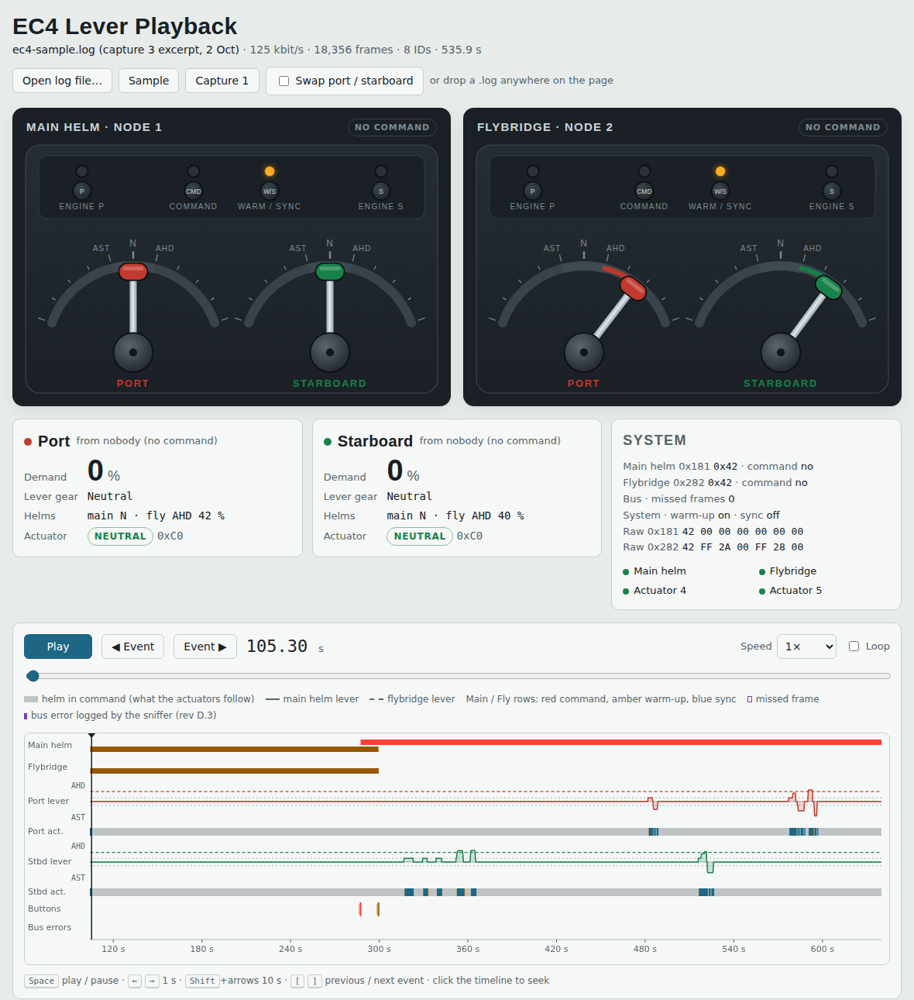
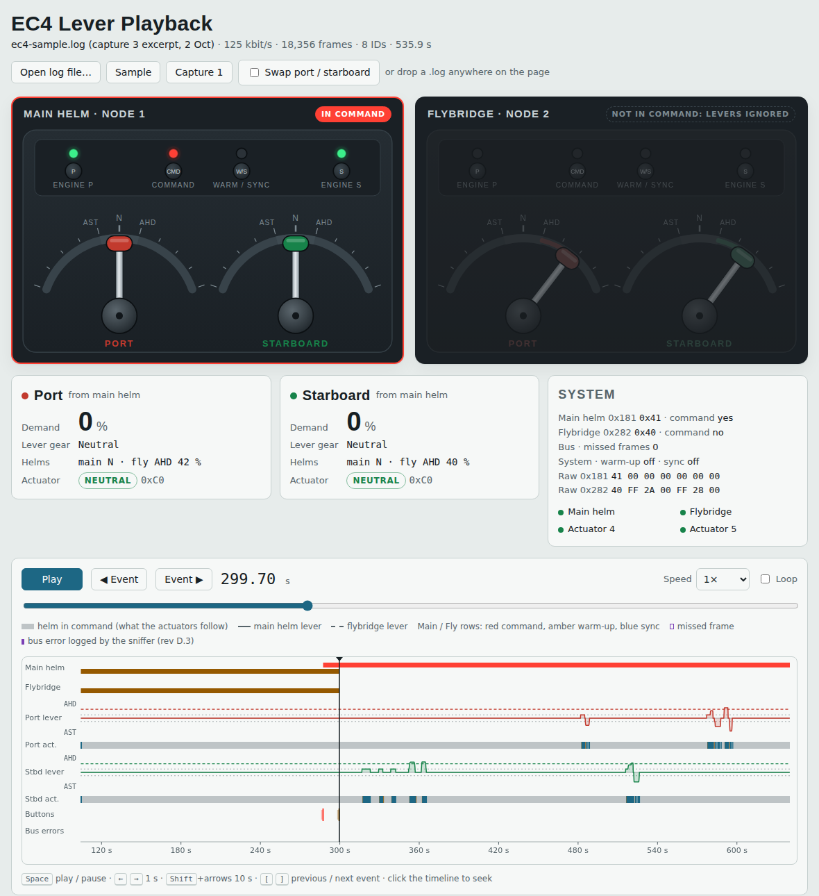
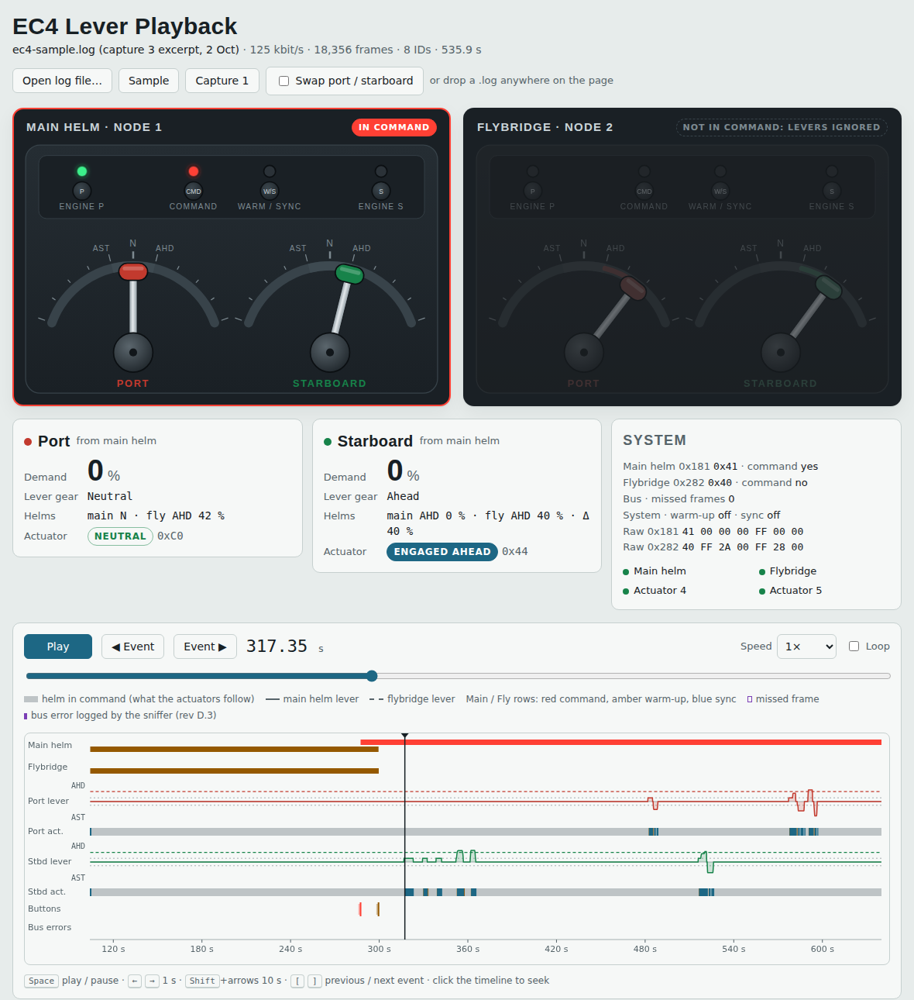
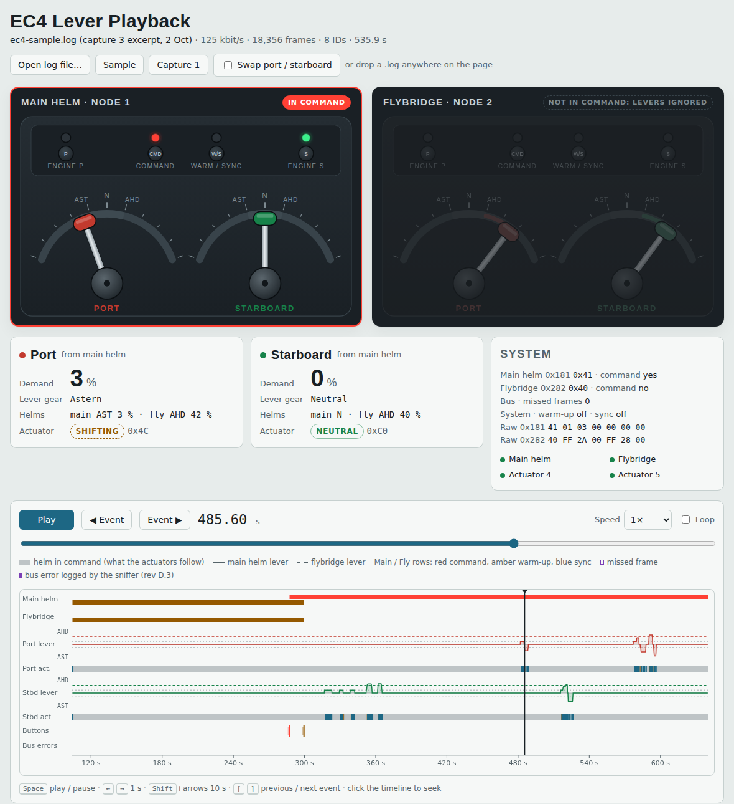
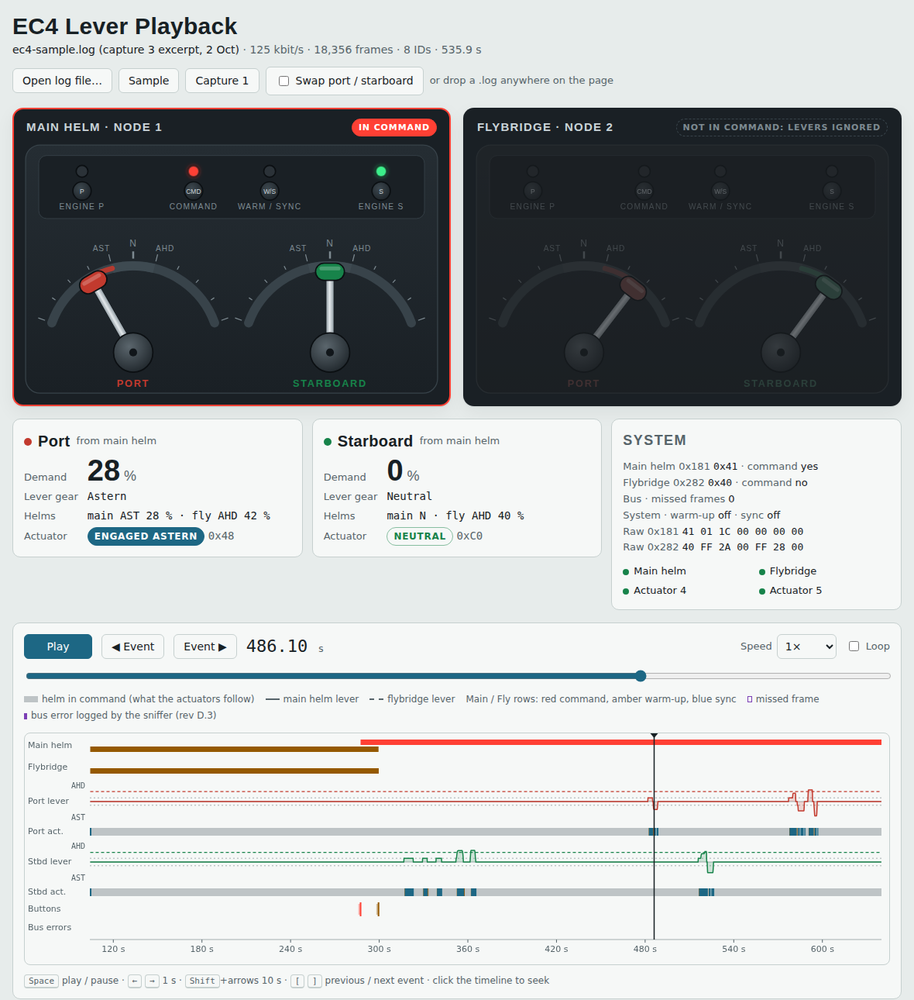
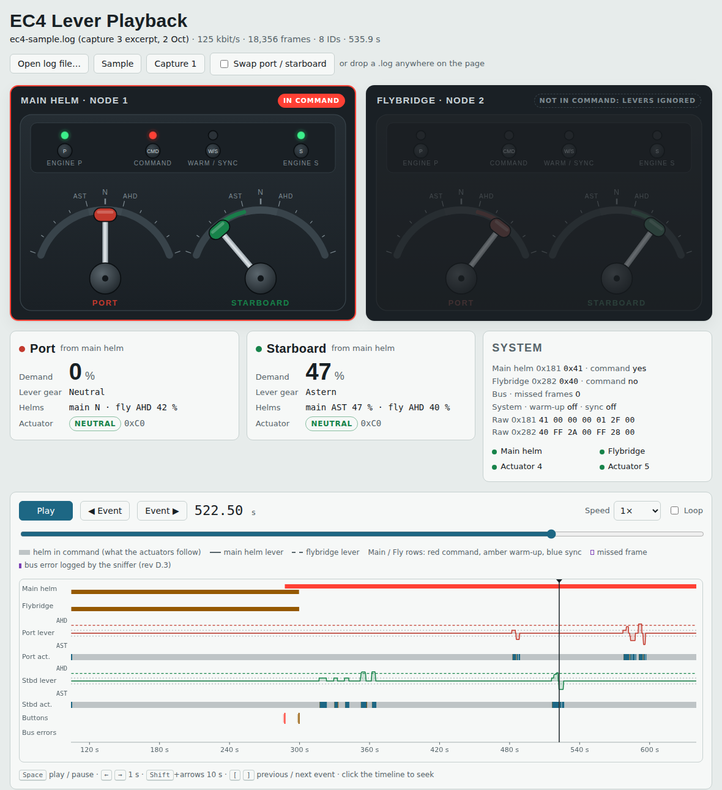
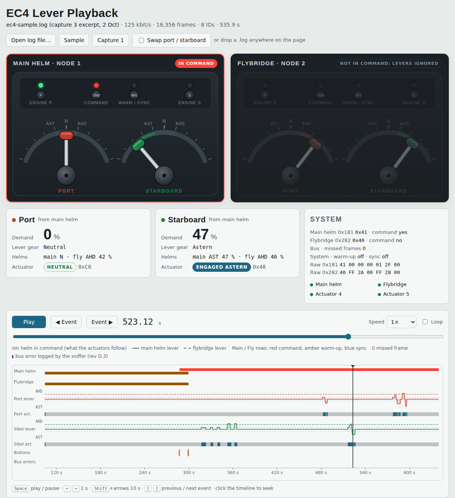

# Event gallery: the sample capture in the viewer

Screenshots of the lever playback viewer (`tools/lever-playback/`) at nine moments in `captures/sample/ec4-sample.log`, an excerpt of capture 3 (2 Oct 2026, 100 to 640 s, 18,356 frames, engines off). Times are log time in seconds. Frame times are receipt times; actuator frames arrive every 153.6 ms, so an actuator change is seen up to one frame late.

Throughout the sample the flybridge levers sit in ahead at 42 % and 40 %, left there after capture 2. They do nothing, because the flybridge never holds command; the main helm does. Once the main helm has command, the viewer dims the flybridge and labels it "Not in command: levers ignored". For simpler pictures with one helm at a time, see `examples.md`.

To reproduce: `python3 tools/lever-playback/build.py`, then `python3 tools/lever-playback/screenshots.py` (Playwright and Chromium).

## 1. Power-on, 105.30 s

The EC4 boots. Both heads send flags 42 (warm-up on, nobody in command). Both actuators report C0 neutral 1.08 s after the first frame. No master and no NMT start: every node starts itself.

## 2. Command taken at the main helm, 287.50 s

Command held at the main helm. Its flags change 42 to 43 in one frame at 287.39 s: in command, warm-up still on. The flybridge stays at 42.

## 3. Warm-up off, 299.70 s

Warm/Sync held: main helm flags 43 to 41 at 299.54 s. The flybridge mirrors it (42 to 40) on its next frame. Gear is now allowed.

## 4. Starboard ahead engaged, 317.35 s

Starboard lever to the ahead detent at 316.79 s (`181#41000000FF0000`). The starboard actuator reports 4C shifting at 317.14 s and 44 ahead engaged at 317.30 s: 0.51 s from lever to gear.

## 5. Starboard throttle at 49 %, 356.30 s

Throttle byte 0x31 = 49 % with the gear byte FF. The actuator stays at 44: the status byte reports gear, not throttle. Lever back to neutral at 356.99 s; actuator C0 at 357.54 s.

## 6. Port fast reversal, shifting, 485.60 s

Labelled "port astern fast". Lever from ahead at idle straight through neutral (485.08 s) to astern (485.53 s). The port actuator passes 4C at 485.47 s on its way out of ahead and reaches C0 at 485.63 s.

## 7. Port astern engaged, 486.10 s

Actuator 48 astern engaged at 486.09 s: 1.00 s from the lever leaving ahead. Lever byte 01 with actuator 48 is the first labelled astern in the captures.

## 8. Starboard reversal from 45 %, 522.50 s

Lever from ahead at about 45 % back through neutral (521.68 s) to astern at 47 % (522.43 s). The station frame showed gear 00 from 521.68 s and throttle 00 from 521.83 s, but the actuator only reaches C0 at 522.49 s: it returns the throttle to idle before it shifts.

## 9. Starboard astern engaged, 523.12 s

4C at 522.95 s, 48 at 523.10 s: 1.42 s from the lever leaving ahead, against 1.00 s for the reversal at idle. The extra 0.4 s is the actuator's throttle-to-idle step. The EC4 adds no neutral dwell of its own.
