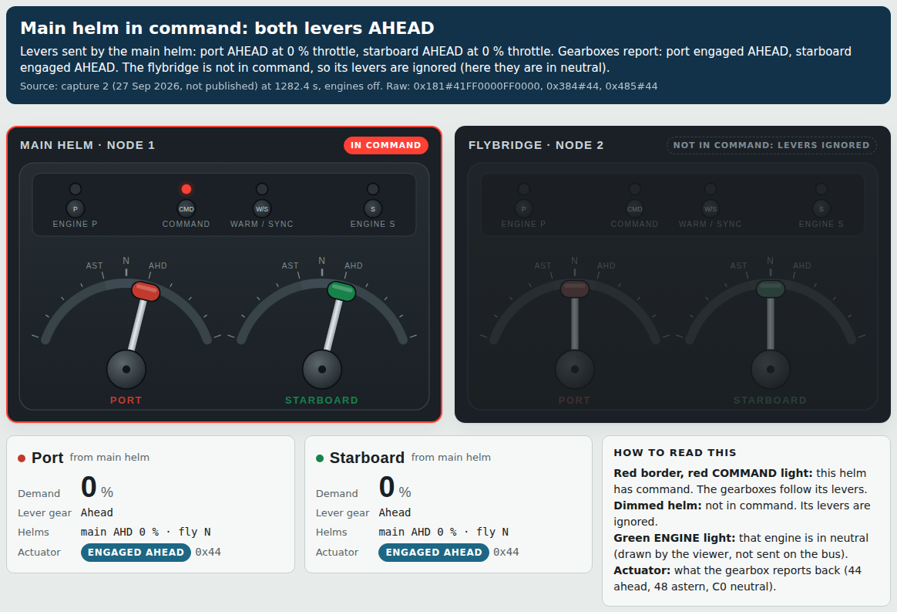
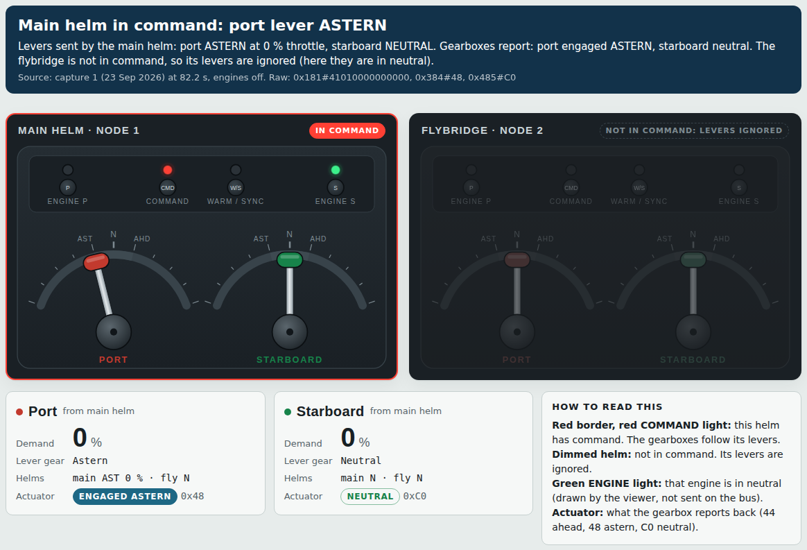
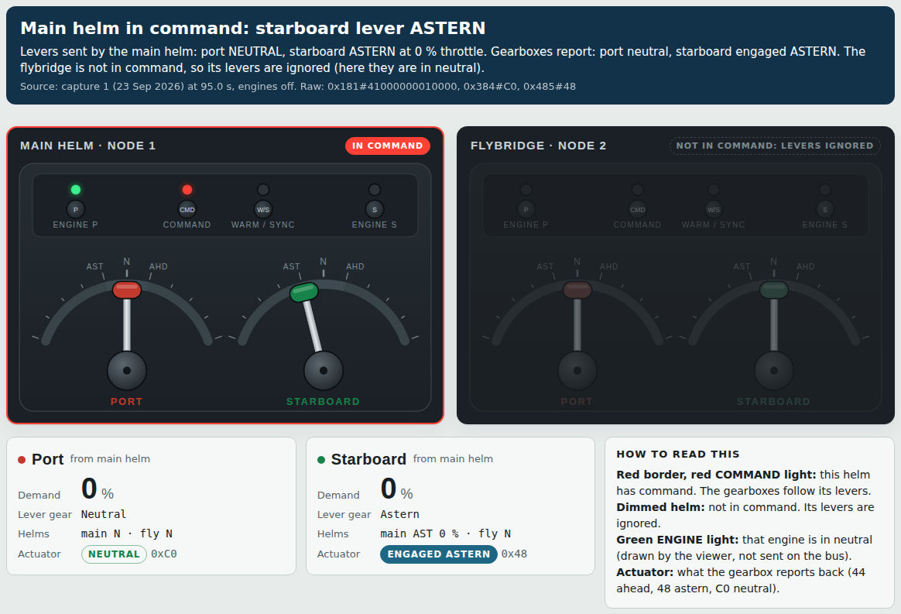
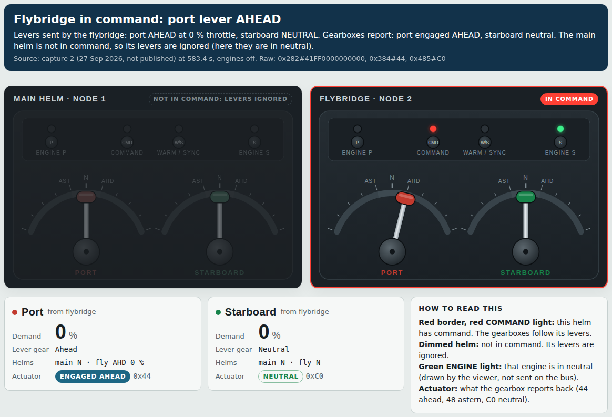
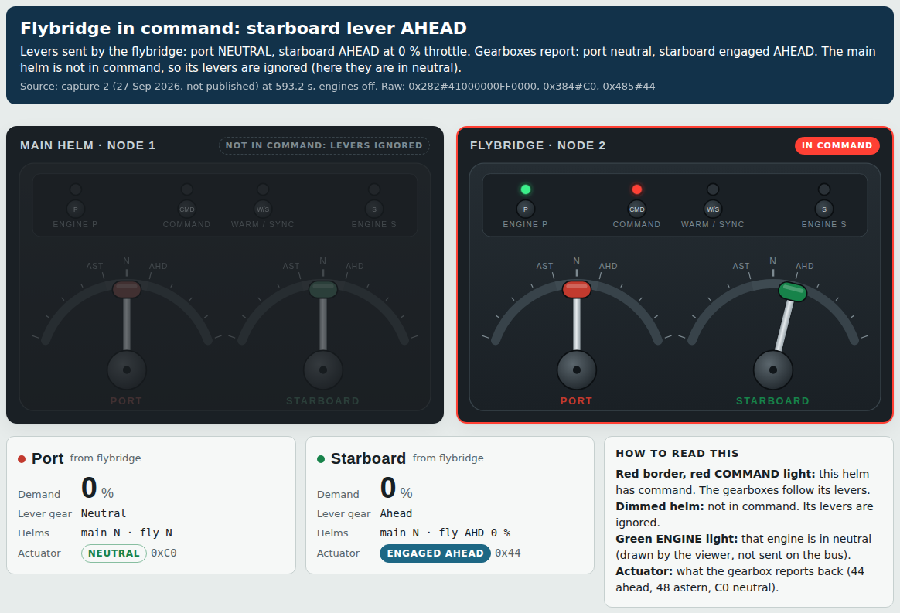

# Simple examples: ahead and astern at each helm

Each picture is one moment from a real capture, engines off, shown in the lever playback viewer. In each one, one helm has command and the other helm's levers are in neutral, so only one set of levers matters. The banner text is generated from the frames at that moment (`tools/lever-playback/examples.py`). Pictures 1, 4 and 5 come from capture 2, which is not published in this release.

How to read them:

- **Red border and red COMMAND light:** this helm has command. The gearboxes follow its levers.
- **Dimmed helm:** not in command. Its levers are still sent on the bus, but the gearboxes ignore them.
- **Green ENGINE light** on the helm in command: that engine is in neutral. The viewer draws this from the actuator status; the head's real lights are not on the bus.
- **Actuator:** what the gearbox reports back: 44 ahead engaged, 48 astern engaged, C0 neutral.

## Main helm, both levers ahead

## Main helm, port lever astern

## Main helm, starboard lever astern

## Flybridge, port lever ahead

## Flybridge, starboard lever ahead

## Flybridge astern: not captured yet

No capture has the flybridge in command with a lever in astern. The flybridge sends the same frame layout as the main helm (0x282 instead of 0x181), so astern is expected to read 01 in the gear byte with the actuator at 48, but that is an inference until it is captured. Next capture: flybridge in command, warm-up off, each lever in turn to the astern detent for 5 s with a note, then both together.

Main helm astern was only ever captured one lever at a time; both levers astern together is on the same list.
