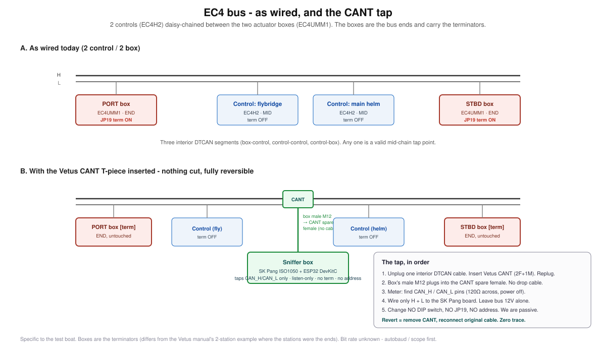

# Tapping the EC4 bus

From the Vetus EC4 manual (sections 7.6 and 7.7) and the installation used for this work.

## Topology

The EC4 bus is a daisy chain with no hubs. Exactly two 120 ohm terminators, on the two devices at the physical ends; everything between has its terminator off. Station termination is DIP switch 1 on the head; actuator termination is JP19 on the actuator box. Station address is DIP 3 and 4; actuator address is JP14.

On the installation used here the two actuator boxes are the bus ends (JP19 on) and the two heads sit between them. That differs from the manual's two-station example, where the heads are the ends. Meter before assuming either.

## The tap: Vetus CANT T-piece

The Vetus CANT T-piece is sold to add a station spur to this bus, so coding, pin count, pinout and gender match by design. Ports: 2 female and 1 male. Inline, its male goes into a device port and one female takes the existing cable's male end, leaving one spare female. The sniffer box carries a male A-coded M12 panel connector and plugs straight onto that spare female: the shortest possible stub, no drop cable.

1. Unplug one interior link, insert the CANT, replug.
2. Plug the box onto the spare female.
3. Meter CAN_H to CAN_L with the EC4 off: about 60 to 67 ohm (two terminators in parallel plus wiring).
4. Wire only CAN_H (black), CAN_L (blue) and 0 V (brown) to the SK Pang terminal. Cap +24 V (white) and the unused grey.
5. Change no DIP switch, no JP19, no address.

To revert: unplug the box, remove the CANT, reconnect the original cable. Nothing is cut.

Mechanical: fix the box to structure so the M12 joint carries signal, not the box's mass under vibration.

## Isolation

The SK Pang board isolates the bus side (ISO1050 plus its own isolated DC-DC). The isolation is only real while the logic side floats. A USB power bank floats. A permanent 12 V feed must go through an isolated converter.
